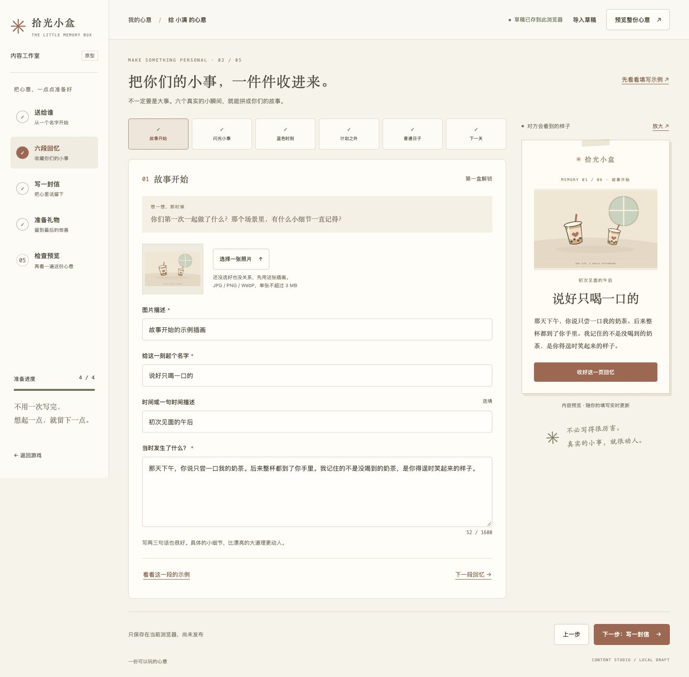

# Memory Arcade / 拾光小盒

一款送给特定的人的惊喜消除游戏，适合生日、纪念日或告白。玩家整理三个回忆盒子，收集六段故事，完成最后的挑战后读信、拆礼物。

默认入口是「藏在日常里的你」。项目基于 React + Vite，使用 2D 插画卡片堆叠。内置示例可直接静态部署；需要通过管理员入口修改故事和礼物时，运行项目自带的 Node 服务即可，无需数据库或邮件服务。仓库自带虚构故事和原创 SVG 示例素材，可以先运行，再换成你们的回忆。

## 快速开始

推荐 Node.js 24，`.nvmrc` 和 GitHub Actions 使用同一版本。依赖支持 Node.js 22.12+（22.x）、24.x 或 26+，不再支持 Node.js 20。

```bash
# 使用 nvm 时先运行 nvm install，再运行 nvm use
npm ci
npm run dev
```

打开终端显示的地址即可游玩。点击「管理员入口」或访问同站点的 `/studio.html`，用 `config/admin.json` 中的密钥登录；默认值为 `whoops2026`。开发服务器已接入管理 API。验证和预览构建产物：

```bash
npm run check
npm run preview
```

`check` 执行测试和生产构建，产物位于 `dist/`。`preview` 是纯静态预览，只显示构建内置的故事，不支持管理员登录或保存。完整生产体验使用 `npm run build && npm start`，默认访问 `http://localhost:3000`。

## 玩法与惊喜流程

```text
打开第一个盒子 → 整理日常小物 → 回忆 1、2
打开第二个盒子 → 整理旅行小物 → 回忆 3、4
挑战最后一个盒子 → 回忆 5、6 → 全部消除
读信 → 拆开礼物、生成邮件卡片 → 摸摸小鹅，发现额外彩蛋
```

点击每列最上层的小物，放入七格收纳槽；三个相同的小物自动消除。槽位满且未能消除时，需撤回、辅助配组或重试当前盒子。全程不计时，没有付费道具。

| 盒子 | 小物数量 | 辅助配组 | 撤回 | 特点 |
| --- | --- | --- | --- | --- |
| 随手收集的小东西 | 18 件 | 不限次数 | 不限次数 | 熟悉收纳与消除 |
| 一起经过的地方 | 36 件 | 不限次数 | 不限次数 | 逐步发现回忆 |
| 礼物前的最后一关 | 36 件、6 种 | 每次挑战 3 次 | 每次挑战 5 次 | 交错堆叠，可查看下一层物品 |

- 每盒消除一半和全部时各解锁一段回忆，可在收藏夹重温。
- 「帮我配一组」会从收纳槽和盒子里凑齐三个同类物品，可能取出被遮挡的小物。
- 最后一盒必须全部消除才能读信、拆礼物；已有无需辅助的参考解法，测试会验证三关均可完成。
- 重试当前盒子会恢复辅助和撤回次数，保留已发现的回忆；撤回或刷新不会退还已用次数。
- 礼物页自动生成邮件形式的纪念卡片，包含收件人、署名、信件与礼物，可下载为 HTML 保存；不会发送邮件，也无需邮箱或 SMTP 配置。
- 礼物页可以再次挑战最后一关；完整重开需确认，会清空三个盒子的进度与回忆。

声音默认关闭，可手动开启。支持触屏、键盘 Tab / Enter、对话框 Escape 关闭和减少动态效果偏好。当前不包含 3D 物理、摇晃手机、真实下单或礼品兑换服务。

## 准备你的故事

| 素材 | 建议准备 |
| --- | --- |
| 开场 | 对方昵称、你的署名、赠送场景、一句开场白 |
| 六段回忆 | 每段的标题、时间描述、几句话及一张图片；也可保留示例插画 |
| 通关后的信 | 3～5 段想对对方说的话 |
| 最终礼物 | 名称、说明、图片及领取方式 |
| 小鹅彩蛋 | 一份额外的小奖励，例如电影任选券 |

推荐使用下面的「内容工作室」填写并点击「保存到游戏」，玩家下次打开或刷新默认三消游戏时就会读取新内容，无需重新构建。若采用纯静态部署，或要修改内置默认内容，仍可修改以下源码并重新构建部署。

| 要改什么 | 修改位置 |
| --- | --- |
| 六段回忆 | [`src/content/story.js`](src/content/story.js) 的 `MEMORIES`：`chapter`、`date`、`title`、`body`、`photo`、`alt`、`accent` |
| 通关后的信 | 同文件的 `FINALE.letter`，数组每项是一段 |
| 礼物 | 同文件的 `REWARDS.gift`：`title`、`description`、`image`、`imageAlt`、`details` |
| 小鹅彩蛋 | 同文件的 `REWARDS.voucher.revealTitle` 和 `description` |
| 新玩法默认昵称、首页标题、开场白、信件署名 | [`src/content/gameContent.js`](src/content/gameContent.js) 的 `DEFAULT_GAME_CONTENT` |
| 浏览器标题与网页描述 | [`index.html`](index.html) |
| 添加到主屏幕后的名称与描述 | [`public/manifest.webmanifest`](public/manifest.webmanifest) |
| 图片与图标 | [`public/content/`](public/content/)、`public/favicon.svg` |
| 物品名称、布局与辅助次数 | [`src/content/match.js`](src/content/match.js)；修改布局后需重新验证可解性与旧存档兼容性 |

`story.js` 中的 `PROJECT` 和 `FINALE` 里除 `letter` 外的字段用于旧版平台闯关，不会修改新玩法的标题或增加告白问答。

请保留六条回忆及现有唯一 `id`，数组顺序就是阅读顺序。`accent` 可选 `rose`、`gold`、`ocean`、`green`。已有存档按序号记录解锁状态；发布后调整回忆顺序会改变玩家已解锁的内容。

例如，把照片放到 `public/content/memory-01.webp`，再修改第一条回忆：

```js
photo: contentAsset('memory-01.webp'),
alt: '一起在海边散步的照片',
```

图片名称变化时，还要同步 [`public/sw.js`](public/sw.js) 的 `CORE` 缓存清单，并递增 `CACHE` 名称。清单仍引用已删除的 SVG 会导致离线缓存安装失败；只改图片内容也要更新缓存版本，避免显示旧素材。详见[发布说明](docs/RELEASING.md)。

## 管理员入口与内容工作室

运行 `npm run dev` 或生产 Node 服务后，在游戏页面点击「管理员入口」，也可直接访问同站点的 `/studio.html`；子目录部署时例如 `/memory-arcade/studio.html`。请通过服务器访问，不要直接双击 HTML 文件。

密钥配置位于 [`config/admin.json`](config/admin.json)：

```json
{
  "adminKey": "whoops2026"
}
```

登录由服务端校验，密钥不会放进前端构建或公开配置 API。默认密钥是已知的初始值，正式部署前请改为自己的值，修改后重启服务。登录会话有效期为 8 小时，服务重启后需重新登录；「退出管理」结束当前会话，保留当前浏览器的草稿。

工作室按「送给谁 → 六段回忆 → 写一封信 → 准备礼物 → 检查预览」引导填写，支持实时预览、示例文案、图片选择和缺项定位。可点击「先看看填写示例」体验完整流程；替换现有草稿前会要求确认。



| 操作 | 保存在哪里 | 何时影响游戏 |
| --- | --- | --- |
| 输入、自动保存草稿 | 当前浏览器的独立 IndexedDB | 不影响游戏，供下次续写 |
| 导出草稿备份 | 下载的 JSON 文件，包含文字与内嵌图片 | 不影响游戏，可重新导入继续编辑 |
| 保存到游戏 | 服务端 `.data/content.json` | 所有玩家下次打开或刷新默认三消游戏时生效 |
| 载入游戏当前内容 | 用服务端内容替换本地编辑草稿，操作前确认 | 不改变已发布内容 |

- 登录后优先恢复本地草稿；没有本地草稿时读取已发布内容。更换设备后，可载入游戏当前内容或导入之前的备份。
- 图片支持 JPG、PNG、WebP，单张不超过 3 MB；选择后需补充图片描述。保存到游戏前必须补齐所有必填内容。
- 导出格式为 `memory-arcade-studio` 版本 `1`，未填完也可以导出备份。清理站点数据、更换域名或浏览器会失去原本地草稿，导出的 JSON 应妥善保管。
- 保存到游戏不清空玩家进度；继续编辑只改变草稿，需要再次点击「保存到游戏」才会发布。调整回忆顺序或内容会影响已有进度所对应的故事。
- GitHub Pages、其他纯静态托管和 `npm run preview` 没有管理 API，无法登录或保存到游戏；仍可玩构建时的默认故事。

界面设计与数据边界见 [`docs/design/content-studio.md`](docs/design/content-studio.md)。

## 进度与离线使用

新玩法通过 `localStorage` 保存棋盘、撤回记录、已用辅助次数、回忆和结局，刷新可续玩。存储键为 `memory-arcade-match-v1`，当前数据版本为 `3`。前两关的旧存档可继续；旧版未完成的第三关会重置为当前布局并保留回忆，已进入信件或礼物的存档保持解锁。

进度仅属于当前浏览器和站点地址，不跨设备同步；更换域名、清理站点数据或使用无痕窗口可能无法继续原进度。存储不可用时仍能玩，但不会保存。小鹅彩蛋的展开状态和声音开关不会保存。

生产构建包含 Service Worker，用于缓存游戏页面和内置素材；开发模式不注册。管理页面与 API 不进入离线缓存，读取已发布故事、登录和保存需要联网。离线缓存不等于内容备份，不应依赖它保留服务端发布的故事。

## 部署

仓库地址：[wzlove/memory-arcade](https://github.com/wzlove/memory-arcade)。游戏访问地址以实际托管平台的部署结果为准。

### Docker 部署（支持管理员配置）

安装 Docker 和 Compose V2 后，在项目根目录运行：

```bash
docker compose up -d --build
```

游戏地址为 `http://localhost:3000/`，后台为 `http://localhost:3000/studio.html`。管理员密钥继续读取 `config/admin.json`（默认 `whoops2026`），配置目录只读挂载，不打入镜像；发布内容保存在 Docker 数据卷 `memory-arcade_content-data`，重建容器后保留。

镜像采用 Node.js 24 多阶段构建，以非 root 用户运行，包含健康检查。已有本地 `.data/` 不会自动导入数据卷，可通过后台导入备份 JSON，再「保存到游戏」。不要用 `docker compose down -v` 更新服务，该命令会删除数据卷。

修改端口、子目录部署、镜像导出与备份恢复见 [Docker 部署说明](docs/DOCKER.md)。

### Node 服务部署（支持管理员配置）

保留项目的 `server/`、`public/studio-model.js`、`config/` 和构建产物 `dist/`，在项目根目录执行：

```bash
npm ci
npm run build && npm start
```

默认游戏地址为 `http://localhost:3000/`，后台为 `http://localhost:3000/studio.html`。生产环境请使用进程管理器保持服务运行，并通过反向代理启用 HTTPS；反向代理需保留访问网站的 `Host`，以便管理 API 校验同源请求。

| 配置 | 默认值 | 用途 |
| --- | --- | --- |
| `config/admin.json` 的 `adminKey` | `whoops2026` | 管理员登录密钥，仅由服务端读取，修改后重启 |
| `PORT` | `3000` | Node 服务监听端口 |
| `HOST` | `0.0.0.0` | Node 服务监听地址；仅本机访问可设为 `127.0.0.1` |
| `BASE_PATH` | `/` | 构建与服务的共同访问前缀，以 `/` 开头和结尾 |

子目录部署时，构建和启动必须使用相同前缀：

```bash
BASE_PATH=/memory-arcade/ npm run build
BASE_PATH=/memory-arcade/ HOST=127.0.0.1 PORT=3000 npm start
```

发布内容保存于 `.data/content.json`，已忽略 Git 跟踪。部署更新时保留 `.data/`；容器或会重建磁盘的托管环境需挂载持久化目录。定期备份该文件，或在后台导出 JSON。恢复服务器备份时停止服务、替换该文件后重启，也可通过后台导入 JSON 并重新「保存到游戏」。没有内容文件时使用内置示例；文件损坏时会报错，需要恢复备份。服务会话保存在内存，当前适合单个 Node 实例运行。

### GitHub Pages

项目已有 [Pages 工作流](.github/workflows/deploy-pages.yml)，推送到 `main` 或手动触发后会安装依赖、运行测试、构建并部署。Pages 只部署静态产物，使用构建时的默认故事；不会同步 Node 服务的 `.data/content.json`，管理员登录与保存不可用。

1. 在仓库 **Settings → Pages → Build and deployment → Source** 中选择 **GitHub Actions**。
2. 将改动合入并推送到 `main`。
3. 查看 **Actions → Deploy to GitHub Pages** 的结果，成功后从 Pages 设置页获取链接。

当前工作流自动把 `BASE_PATH` 设置成 `/仓库名/`。若使用 `用户名.github.io` 根站点或自定义域名，将工作流中的 `BASE_PATH` 改为 `/`；只改 `vite.config.mjs` 的默认值不会覆盖工作流环境变量。[路径配置说明](https://vite.dev/guide/static-deploy.html)

GitHub Free 的 Pages 面向公开仓库；私有仓库需要支持该功能的付费方案。私有仓库不等于私密网站，普通 Pages 站点仍公开可访问。[GitHub Pages 说明](https://docs.github.com/en/pages/getting-started-with-github-pages/configuring-a-publishing-source-for-your-github-pages-site)

### 其他静态托管或自有服务器

```bash
# 部署在域名根目录
npm run build

# 如果部署在 /memory-arcade/ 子目录，改用这一条构建
BASE_PATH=/memory-arcade/ npm run build
```

上传 `dist/` 内的文件到对应网站目录，启用 HTTPS。此方式只提供构建时的默认故事，不支持管理员登录或保存；需要后台配置时使用上面的 Node 服务部署。需要仅指定的人访问时，选择带身份验证的托管服务或在服务器配置访问控制。

## 原版平台闯关

原版「拾光冒险」保留在同一站点的 `?mode=platformer` 入口，例如本地的 `http://localhost:5173/?mode=platformer`（端口以终端显示为准）。

旧版通过移动、跳跃和顶砖寻找六枚记忆碎片，再抵达终点读信、回答最终问题。隐藏房与代金券属于额外支线，不影响主线通关。旧版不保存闯关进度，刷新会重开；与默认三消玩法的存档相互独立。两种玩法的内置示例共用 `story.js` 中的回忆、信件和奖励素材。后台发布内容目前只应用于默认三消玩法，旧版仍读取源码中的故事。

基于 [juliantanx/memory-arcade](https://github.com/juliantanx/memory-arcade) 改造，保留原项目的 MIT 许可证。

## 项目结构

```text
src/App.jsx                   # 根据 URL 选择玩法
src/PlatformerApp.jsx          # 原版平台闯关入口
src/components/MatchGame.jsx   # 三消界面、回忆与礼物
src/components/KeepsakeArt.jsx # 小物 SVG 插画与图标
src/content/story.js          # 两种玩法共用的内置故事素材
src/content/gameContent.js    # 默认三消读取已发布内容
src/components/CompletionMail.jsx # 通关邮件卡片预览与下载
public/studio.html            # 管理员内容工作室入口
public/studio-model.js        # 前后端共用的配置格式与校验
server/admin.js              # 管理员会话与发布内容 API
server/index.js              # 生产 HTTP 与静态文件服务
config/admin.json            # 服务端管理员密钥
.data/content.json           # 已发布故事，运行时生成并需备份
src/content/match.js          # 三消物品、关卡与参考解法
src/game/MatchGame.js          # 三消规则与存档校验、迁移
src/game/MatchGame.test.js     # 三消规则测试
src/game/                     # 同时保留旧版游戏引擎与音频
src/match.css                 # 三消页面样式
public/content/               # 回忆和礼物素材
public/sw.js                  # 生产环境离线缓存
.github/workflows/            # CI 与 Pages 部署
```

## 隐私、贡献与许可证

照片、信件和礼物内容会通过静态资源或公开的内容 API 发送给浏览器。管理员登录只保护内容修改，通关解锁不提供加密或阅读权限控制，不能把游戏当作秘密保险箱。请使用获授权的素材，不要在故事、礼物说明、导出文件或 Git 历史中保存真实兑换凭证、私人访问令牌等不应公开的信息。邮件卡片仅供预览和下载，不会自动发送。

- [发布说明与验收清单](docs/RELEASING.md)
- [贡献指南](CONTRIBUTING.md)
- [安全问题报告](SECURITY.md)
- [MIT 许可证](LICENSE)：覆盖代码与原创示例素材，个人上传素材需另行确认权利。
